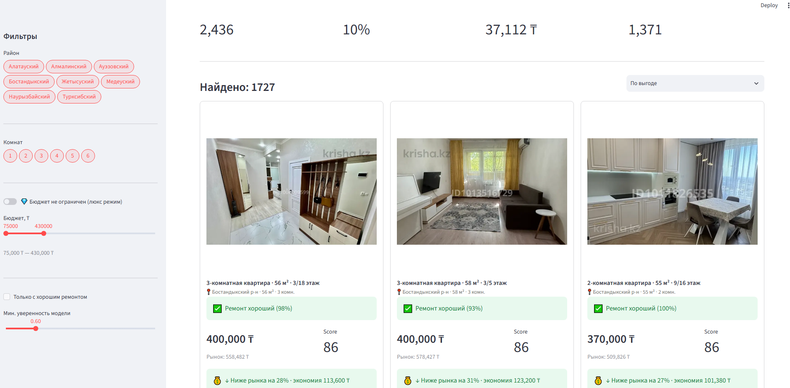

# 🏠 Krisha Analytics

**[Открыть живое приложение](https://krisha-analytics-lxtmguvfkmjapzdyn4uemj.streamlit.app/)**

AI-инструмент для поиска недооценённых квартир на рынке аренды/продажи недвижимости Казахстана (krisha.kz).

## Что делает проект

Приложение анализирует объявления о недвижимости и находит квартиры с **хорошим ремонтом по цене ниже рынка**:

-  Собирает данные с krisha.kz через веб-парсинг
-  Оценивает качество ремонта по фотографиям через компьютерное зрение (CLIP + XGBoost)
-  Сравнивает цену с рыночной по району, комнатности и ценовому сегменту
-  Показывает топ выгодных предложений в интерактивном веб-приложении

## Как это работает

```
1. parser_pg.py      → собирает объявления с krisha.kz в PostgreSQL
2. labeling.py        → ручная разметка обучающей выборки (GOOD/BAD ремонт)
3. train_model_v4.py  → обучение модели: CLIP (embeddings) + XGBoost (классификация)
4. predict.py         → применение модели ко всем объявлениям в базе
5. app_v3.py           → Streamlit-приложение для поиска и фильтрации
```

## Модель

- **Точность: 87%** на отложенной выборке
- Признаки: embeddings изображений от CLIP (openai/clip-vit-base-patch32)
- Классификатор: XGBoost с подбором гиперпараметров через GridSearchCV
- Обучающая выборка: 400+ вручную размеченных квартир

## Стек

`Python` · `PostgreSQL` · `BeautifulSoup` · `PyTorch` · `Transformers (CLIP)` · `XGBoost` · `scikit-learn` · `Pandas` · `Streamlit`

## Скриншот



## Запуск

```bash
pip install -r requirements.txt

python -m streamlit run app_v3.py
```

Для веб-приложения создай `.streamlit/secrets.toml` (не коммить этот файл):

```toml
DB_HOST = "localhost"
DB_PORT = "5432"
DB_NAME = "krisha"
DB_USER = "postgres"
DB_PASSWORD = "your_password"
```

В Streamlit Cloud оставь существующие значения **Settings → Secrets**. Приложение по-прежнему запускается из `app_v3.py`, читает таблицу `listings` и использует те же настройки `DB_*`. Миграции базы, переобучение модели и перенос хостинга не нужны.

## Новый интерфейс

- Тёмная графитовая тема с мятными акцентами.
- Фильтры над результатами; дополнительные настройки модели раскрываются отдельно.
- Большой просмотр выбранной квартиры: все уникальные фотографии, миниатюры, соседние объявления, рыночная оценка и исходная ссылка на krisha.kz.
- Кнопка сворачивания большого просмотра и сетка карточек с действием «Смотреть».
- Избранное на время Streamlit-сессии; при новой сессии оно сбрасывается.
- Пагинация сбрасывается при изменении фильтров и сортировки. Выбранная квартира сохраняется по ID, пока присутствует в результатах.

Фото, цены, районы и ссылки берутся из текущей БД. Демонстрационных объявлений в приложении нет. SQL-запрос, сегментация рынка и формула `deal_score` сохранены. Режим «Бюджет не ограничен» по-прежнему меняет формулу рейтинга, а выбранный диапазон цены продолжает действовать.

Оформление: `assets/styles.css` и `.streamlit/config.toml`; безопасное отображение данных и разбор фотографий: `ui_helpers.py`. Поддерживаются и JSON-строки, и массивы JSONB с фотографиями.

### Проверка без доступа к реальной БД

```bash
pip install pytest
python -m pytest -q tests
```

Тесты запускают настоящее Streamlit-приложение с подменённым подключением и тестовыми данными. Производственные Secrets не требуются.

## Автор

Пет-проект для практики Data Analysis / ML.
